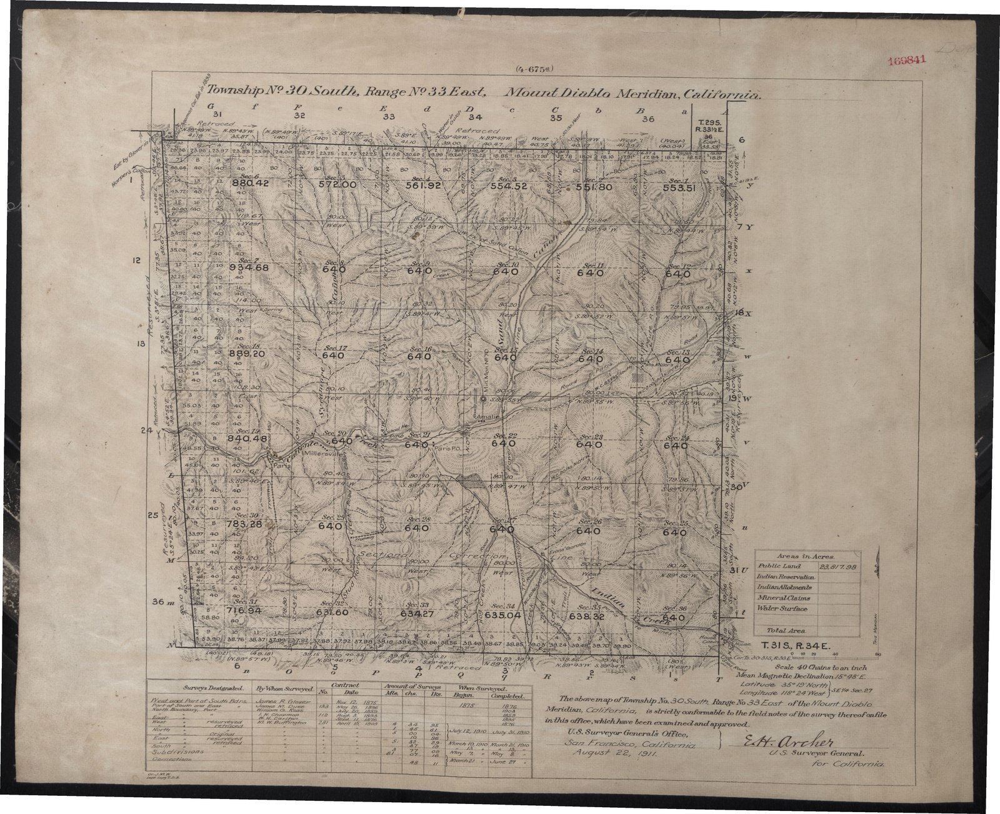

# Georeferencing a GLO cadastral plat from BLM PLSS corners (T30S R33E, Kern Co., CA)

An R script that georeferences a scanned 1911 General Land Office plat using the
BLM's published section and quarter corners as control points, and a thin plate
spline warp (GDAL). Built for locating features in **Studhorse Canyon**
(Secs 20, 29, 32), but it georeferences the whole sheet.



## What you get
* `T30S_R33E_georef_TPS_UTM11N.tif` : the plat in NAD83 / UTM 11N (EPSG:26911), RGBA
* `gcp_clicks.csv` : your clicked control points (resumable)
* `gcp_report.csv` : per-point leave-one-out error in metres
* `T30S_R33E_plat.kmz` : Google Earth overlay (optional)

## Quick start
1. Install R packages: `source("install_requirements.R")` (see [REQUIREMENTS.md](REQUIREMENTS.md)).
2. Get the scan (below) and save it as `T30S_R33E_Kern_1911_native.jpg`
   (or change `scan_file` in the script's CONFIG block).
3. Open `T30S_R33E_plat_georeference.R` in **RStudio or the R GUI** (not Rscript),
   set the working directory to the folder with the scan, and run it.
4. The script zooms to where it predicts each corner; click the exact
   section-line intersection. Right-click or `s` skips a corner. Progress is
   saved after every click, so you can quit and resume.
5. Check the accuracy table, then press Enter to warp.

### Skip the clicking (use the example clicks)
Copy the three files in `data/T30S_R33E/` next to the script and the scan, then run it.
It will find the existing clicks, skip the click loop, report accuracy and warp.
This only works with the **same scan image** (5193 x 4241 px), because the clicks
are pixel positions.

### Check the numbers without the scan
`source("check_example_accuracy.R")` recomputes the leave-one-out accuracy of the
example clicks in base R. Expected: median 6.1 m, 90th percentile 16.3 m, max 21.7 m.

## Getting the scan
The scan is not in this repository (size, and it is a public record you should
obtain from the source). The example used the plat PDF
`T30S_R33E_Kern_1911_CA210300S0330E00001.PDF` from the BLM General Land Office
records. Extract the embedded image without resampling:

```
pdfimages -png T30S_R33E_Kern_1911_CA210300S0330E00001.PDF scan
```

(`pdfimages` is part of poppler.) This gives a 5193 x 4241 px image. Save it as a
high-quality JPEG or PNG and point `scan_file` at it. The script accepts any RGB image GDAL can read.

## Accuracy (example, 56 control points)
Leave-one-out error: median 6.1 m, 90th percentile 16.3 m, maximum 21.7 m.
Edge corners are worst (extrapolated); the interior is tighter. This is the
accuracy of the **plat sheet**, not of features sketched on it: the canyon line
is a surveyor's sketch and can be off by more than the warp. Details in
[docs/METHOD.md](docs/METHOD.md).

## Other townships
The script is written for T30S R33E. For another township change `township_id`
and the file names, and **verify the `POINTLAB` decoding** described in
[docs/METHOD.md](docs/METHOD.md); it was worked out from this township's data and
may differ elsewhere. `exclude_labs` and `priority_E/N` are specific to this sheet.

## Files
| | |
|---|---|
| `T30S_R33E_plat_georeference.R` | the script (edit the CONFIG block only) |
| `check_example_accuracy.R` | base-R accuracy check |
| `install_requirements.R`, `REQUIREMENTS.md` | dependencies |
| `data/T30S_R33E/` | BLM corner table, example clicks, example report |
| `docs/` | method notes, preview image |

## Data and credits
* PLSS corner coordinates: BLM CadNSDI, California PLSS corner points (public ArcGIS REST service).
* Plat: GLO/BLM historical records.
* Corner coordinates carry BLM's own stated reliability; see METHOD.md.

## License
No license has been chosen yet. Add a `LICENSE` file before sharing publicly.
(Code and data licensing are separate: BLM and GLO material are public records.)
